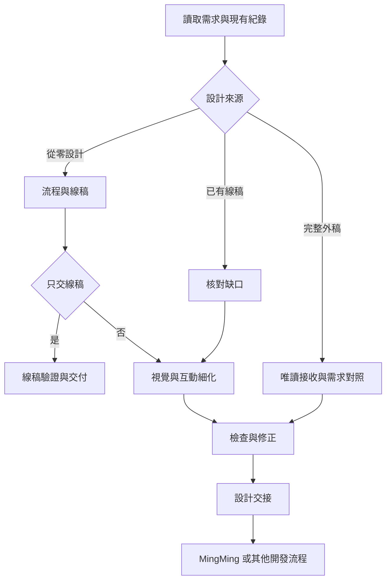

# Ming-design-loop

**Ming-design loop v1.0.0** 是可獨立使用的 UIUX 設計工作流，也能透過文件與證據交接給 MingMing 或其他開發團隊。

適合需要自行完成設計、接續既有線稿，或與外部 UIUX 設計師合作的專案。線稿與精緻 UI 分階段，使用者體驗的檢查貫穿整個流程。

## 功能

- **三種入口**：從零設計、接續線稿、接收外部設計。
- **彈性交付**：只做線稿、完整 UIUX、交接整理、唯讀審查或局部修改。
- **兩種深度**：精簡模式減少探索與重複製作；完整模式依需要增加流程、裝置與互動覆蓋。
- **Figma 交付**：透過可用 MCP 產出可編輯畫面，核對圖層、元件、Auto Layout 與實際截圖。
- **證據與版本**：記錄已驗證、尚未驗證及設計變更後需要重新檢查的範圍。
- **自主推進**：已有來源與授權就繼續，重要產品缺口才詢問，不要求每階段回答「繼續」。

## 安裝

這是一個以 Markdown 規範與模板組成的 Codex Skill，不含執行腳本，不需要安裝 npm 或 Python 套件。

將此儲存庫的內容放入 Codex 的 `skills/ming-design-loop/` 資料夾，確保 `SKILL.md` 位於該資料夾根目錄。一般個人安裝位置為 `~/.codex/skills/ming-design-loop/`；若有自訂 Codex home，使用該位置下的 `skills/`。

Windows PowerShell 的首次安裝範例：

```powershell
git clone --branch v1.0.0 --depth 1 https://github.com/jacky105402002/Ming-design-loop.git "$env:USERPROFILE\.codex\skills\ming-design-loop"
```

已安裝同名技能時先比較差異與備份，不直接覆蓋個人修改。也可從 GitHub 的 `v1.0.0` 標籤下載 ZIP，再放到上述位置。

在技能已載入的聊天使用 `$ming-design-loop`；若尚未出現在技能清單，於新聊天確認載入情形。

## 使用範例

### 獨立從零設計

> 使用 $ming-design-loop，獨立進行設計，不搭配 MingMing。依這份需求採精簡模式，先完成流程線稿，再製作 UI。Figma 目標為〈檔案連結〉，可在〈指定頁面〉建立及修改本次設計。

### 只做線稿

> 使用 $ming-design-loop，這次只完成活動報名流程的手機版線稿與必要狀態，不做精緻 UI。需求文件在〈位置〉。

### 接續設計師線稿

> 使用 $ming-design-loop，這是已確認的線稿〈連結〉，請保留既有流程，補齊必要缺口後完成視覺與互動設計。

### 接收外部完整設計

> 使用 $ming-design-loop，唯讀接收這份 Figma〈連結〉，對照專案需求並整理開發交接，不修改原稿。

### 與 MingMing 搭配

> 使用 $ming-design-loop，沿用本案 MingMing 的需求、驗收條件與技術限制，完成設計後整理給主線的交接文件與證據。

## 流程



## Figma 與開發流程

Figma 是可選的設計工具；要求可編輯 Figma 交付時，需具備對應連線、檔案權限與寫入能力。可搭配第三方 Figma Console MCP 或其他具備所需能力的連接器，每次核對當前工具文件與實際能力。本儲存庫不包含或自動安裝 MCP。

完整交付要求適用的可編輯文字／圖層、元件、版面規則與驗證證據。連線受阻時可繼續規格工作，但不把尚未完成的 Figma 稿標記為完成。

MingMing 是可選的開發接續方式。本版採文件層接口，沿用產品已導入的 MingMing 版本，不自動升級、不更改主線狀態格式，也沒有背景自動同步。

## 文件與模板

| 檔案 | 用途 |
|---|---|
| [SKILL.md](SKILL.md) | 技能入口、任務分流與交付邊界 |
| [workflow.md](references/workflow.md) | 設計階段、工作量與接續規則 |
| [quality.md](references/quality.md) | 品質檢查與證據標準 |
| [figma-adapter.md](references/figma-adapter.md) | Figma 操作、重試與驗證 |
| [mingming-handoff.md](references/mingming-handoff.md) | 外部設計與開發交接 |
| [research.md](references/research.md) | 參考來源與採用取捨 |
| [project-brief.md](assets/project-brief.md) | 專案設計需求模板 |
| [design-record.md](assets/design-record.md) | 唯一設計進度與決策紀錄模板 |
| [design-handoff.md](assets/design-handoff.md) | 設計交接模板 |
| [review-record.md](assets/review-record.md) | 每輪檢查證據模板 |

模板複製到產品專案使用；既有專案有等價格式時對應合併，避免同時維護兩份需求或進度。客戶資料、秘密與實際設計紀錄不應填回共用技能。

## 版本與驗證

目前版本：**1.0.0**。詳見 [版本紀錄](CHANGELOG.md)與[驗證說明](docs/validation.md)。

已完成技能基本格式、文件引用與套件結構檢查，以及 12 個情境的作者自我審查。實際 Figma 寫入、原型操作與 MingMing 產品專案端到端交接尚未驗證；文件通過不代表實際產品、無障礙或資安驗收通過。
